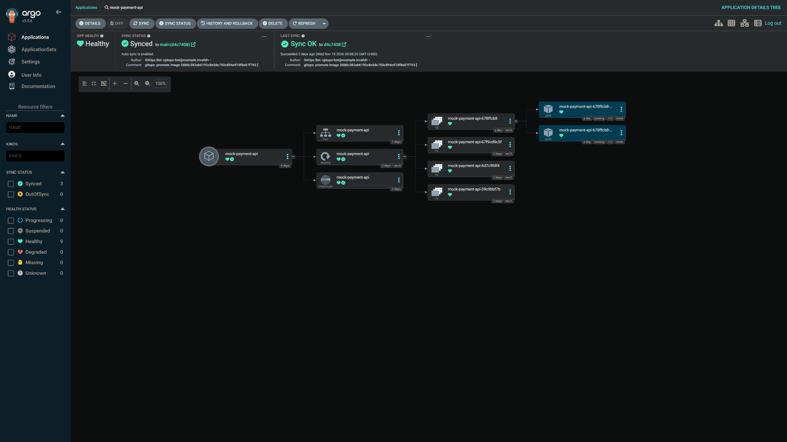

# GitOps validation — 2026-11-17

## Automated delivery

- GitLab CI: Python unit tests, Helm lint/render, rootless BuildKit image publish, serialized GitOps promotion (`[skip ci]`).
- A source-only commit triggered the pipeline. The operator observed automatic Argo CD Sync in the UI (no manual Sync).
- Deployed registry tag: `26e76974280974487a3716a1126c5b88034e0402` (full source commit SHA).
- Result: Argo CD `Synced / Healthy`; `deployment/mock-payment-api` rollout succeeded (2/2 replicas).
- Verified CI pipeline: [#3080260304](https://gitlab.com/pavel_petrikovskiy/payment-platform-gitops-lab/-/pipelines/3080260304) — success.
- Source commit: [26e7697](https://github.com/palandrp/payment-platform-gitops-lab/commit/26e76974280974487a3716a1126c5b88034e0402).
- Successful CI jobs:
  - [python-unit-tests](https://gitlab.com/pavel_petrikovskiy/payment-platform-gitops-lab/-/jobs/18116014544)
  - [helm-chart-validation](https://gitlab.com/pavel_petrikovskiy/payment-platform-gitops-lab/-/jobs/18116014545)
  - [build-container](https://gitlab.com/pavel_petrikovskiy/payment-platform-gitops-lab/-/jobs/18116014546)
  - [promote-gitops](https://gitlab.com/pavel_petrikovskiy/payment-platform-gitops-lab/-/jobs/18116014547)
- GitOps promotion commit: [6d38f64](https://github.com/palandrp/payment-platform-gitops-lab/commit/6d38f64aa0c5b09da6fe4b310b237881b5d908f3).
- Argo CD synchronization and rollout were verified in the cluster.

## Self-healing

With Argo CD `automated.enabled=true`, `selfHeal=true`, `prune=false`, the operator scaled the Deployment from two to one replicas. Argo CD restored the desired two replicas and the rollout completed without a manual Sync. Pruning was **not** tested.

## HTTP routing

- `payment-demo/mock-payment-api` HTTPRoute attached to `default/nginx-gateway`: `Accepted=True`, `ResolvedRefs=True`.
- Request using Host `payment.lab.internal` through NGINX Gateway NodePort returned HTTP 200 from `/api/v1/info`.
- Pre-existing `default/web` route still returned HTTP 200.
- The Gateway listener's cross-namespace `allowedRoutes` configuration was patched manually; it is **not** managed by the payment Application.

## Operational limitations

- Weave Net lost cross-node Pod connectivity following VM suspend/resume. Tested DNS and HTTP recovered on a working path after Weave rolling restart, but `node01` remained cordoned. Full recovery was not demonstrated.
- Two-member etcd and a single HAProxy are accepted lab risks, **not** production HA.
- HPA manifest rendering passed; runtime autoscaling and Prometheus monitoring were not tested.
- This is a mock payment API, not real payment processing.

## Reproduce non-disruptive checks

```bash
python3 -m unittest discover -s tests -v
helm lint charts/mock-payment-api --strict
helm template mock-payment-api charts/mock-payment-api --namespace payment-demo
kubectl -n argocd get application mock-payment-api
kubectl -n payment-demo rollout status deploy/mock-payment-api
kubectl -n payment-demo get httproute mock-payment-api
```

### Argo CD deployment evidence

The following screenshot shows the application in a
Synced / Healthy state, with its Kubernetes resource tree.



Note: This screenshot captures the application state at the
time of capture. The historical CI pipeline and source commit
are linked above.
